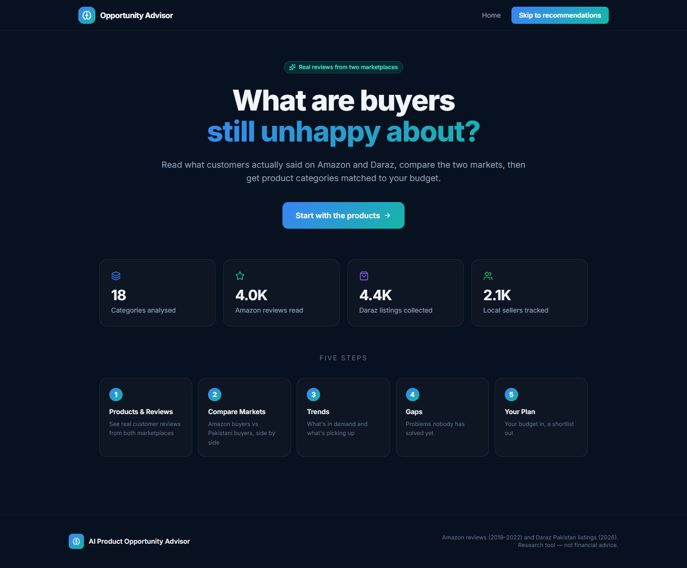
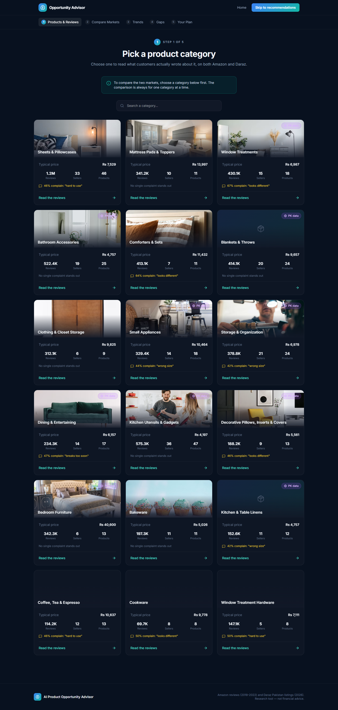
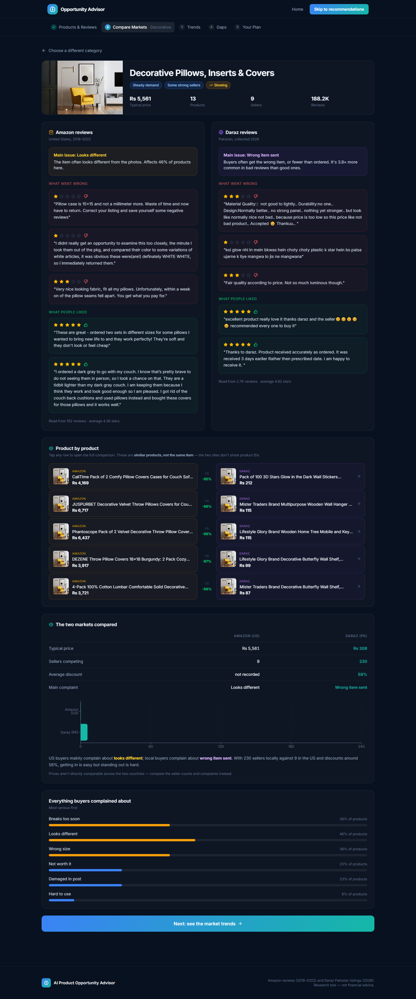
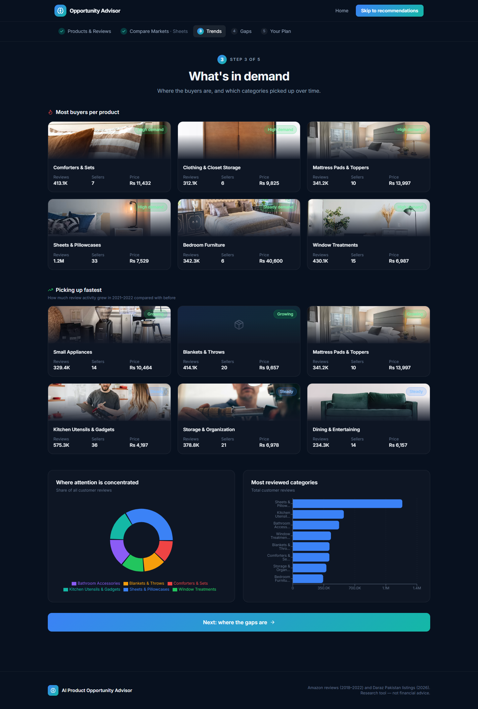
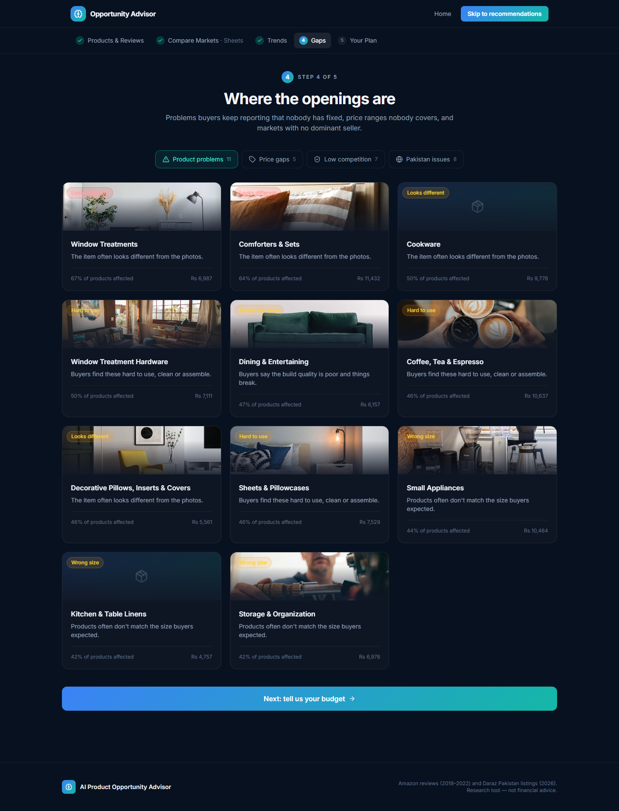
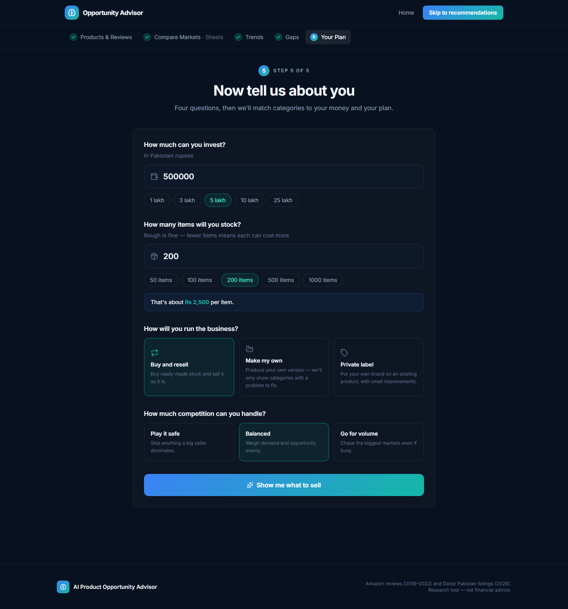
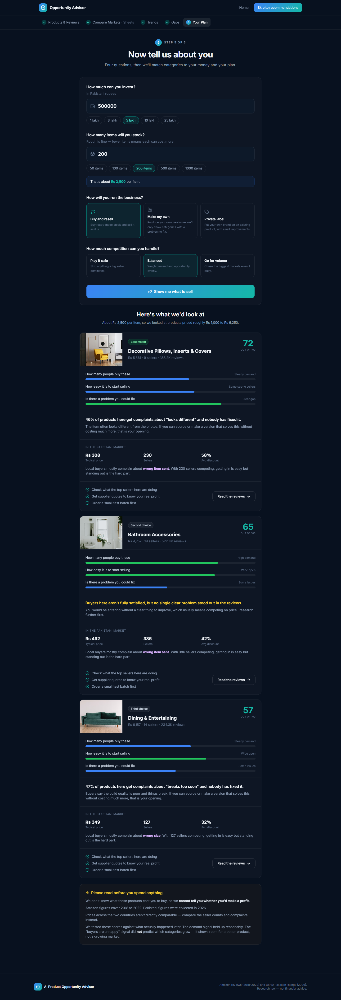

# AI Product Opportunity Advisor

A research tool that helps entrepreneurs in Pakistan find product categories worth selling.
It reads real customer reviews from **Amazon** (2018–2022) and real listings from
**Daraz Pakistan**, compares the two markets side by side, and turns a budget, a quantity
and a risk appetite into a short, explained list of categories to look at.

Nothing on screen is hardcoded. Every number comes from the parquet files produced by the
analysis pipeline in `data/clean/`, served by a small Flask API to a React + Tailwind UI.



---

## What it does

The UI walks the user through five steps. A step bar at the top tracks progress and lets
them jump back at any point.

| Step | Page | What the user sees |
|---|---|---|
| 1 | **Products & Reviews** | Every analysed category as a card. Open one to read what customers actually wrote, split into what went wrong and what they liked, for Amazon and Daraz separately. |
| 2 | **Compare Markets** | The same category on both sides: prices, seller counts, discounts, concentration and the main complaint each market reports. |
| 3 | **Trends** | Most buyers per product, what is picking up fastest, where attention sits. |
| 4 | **Gaps** | Product problems nobody has solved, price gaps, low-competition markets, Pakistan-specific issues. |
| 5 | **Your Plan** | Budget, quantity, business model and risk in; three recommended categories out, each with the reasons. |

### Screenshots

**Step 1 – pick a category**



**Step 2 – category detail: real reviews from both marketplaces and the two markets compared**



**Step 3 – trends**



**Step 4 – gaps**



**Step 5 – your plan (input form and recommendations)**





---

## Tech stack

- **Backend:** Python 3.12, Flask, pandas, pyarrow. One file: `server.py`.
- **Frontend:** React 19, TypeScript, Vite, Tailwind CSS 4, Recharts, lucide-react.
- **Data:** parquet / CSV outputs of the analysis pipeline (see below).

```
server.py                Flask backend: loads parquet, serves the JSON API and the built UI
fetch_product_images.py  Optional helper that recovers Amazon product photo URLs
src/App.tsx              The whole UI (home, categories, detail, compare, trends, gaps, advisor)
src/api.ts               Typed API client, the only place that talks to Flask
src/index.css            Design tokens and Tailwind setup
data/clean/              Data files read by the server
docs/screenshots/        Images used in this README
dist/                    Built UI, created by `npm run build` (not committed)
```

---

## Quick start

Requirements: Python 3.10+ and Node 18+.

```bash
# 1. clone
git clone <this-repo-url>
cd opportunity-advisor

# 2. backend dependencies
python -m venv .venv
.venv\Scripts\activate          # Windows
# source .venv/bin/activate     # macOS / Linux
pip install -r requirements.txt

# 3. frontend dependencies + build
npm install
npm run build

# 4. run
python server.py
```

Open **http://localhost:5000**. The console lists which data files loaded and how
many categories were found. The same information is at `/api/health`.

To open it from a phone or another laptop on the same wifi, find your IP
(`ipconfig` on Windows) and use `http://192.168.x.x:5000`.

### Developing the UI

Run two terminals so the UI hot-reloads:

```bash
python server.py   # terminal 1: API on :5000
npm run dev        # terminal 2: Vite dev server with hot reload
```

In dev mode the frontend calls `http://localhost:5000` for the API automatically
(see `src/api.ts`). In the built version it uses relative URLs, so one server serves both.

---

## Data files

`server.py` reads these from `data/clean/`. Point it somewhere else with the
`DATA_DIR` environment variable.

| File | Used for | Required |
|---|---|---|
| `opportunities.parquet` | Every category: demand, competition, prices, complaint, scores | **yes** |
| `daraz_niche_gaps.parquet` | The Pakistan side of every comparison | recommended |
| `features_full.parquet` | Per-category issue breakdown, best-rated products, price bands, sellers | recommended |
| `reviews_topics.parquet` | Real Amazon review text shown on the category page | recommended |
| `daraz_reviews_credible.csv` | Real Daraz review text shown next to it | recommended |
| `daraz_features_clustered.parquet` | Top Daraz listings per category | optional |
| `meta_filtered.parquet` | Amazon product titles and metadata | optional |
| `validation_results.parquet` | "Picking up fastest" on the trends page | optional |
| `product_images.parquet` | Real Amazon product photos (see below) | optional |

If an optional file is missing, that section is simply omitted. Nothing breaks.

```bash
# use a different data folder
set DATA_DIR=C:\path\to\data\clean      # Windows
export DATA_DIR=/path/to/data/clean     # macOS / Linux
python server.py
```

### Product photos

The Amazon metadata in this repo was built with the `images` column dropped. To get
real product photos, run the helper from the folder that holds the full pipeline data:

```bash
python fetch_product_images.py
```

It writes `data/clean/product_images.parquet`. Copy that file into this project's
`data/clean/` and restart the server. Anything without a photo falls back to the category
picture, and a failed image falls back to a gradient placeholder.

---

## API

| Endpoint | Returns |
|---|---|
| `GET /api/health` | Which data files loaded, how many categories |
| `GET /api/overview` | Headline counts for the home page |
| `GET /api/categories` | All categories with scores and labels |
| `GET /api/category/<id>` | One category with issues, reviews, top products, price bands, sellers |
| `GET /api/trends` | High demand, growing, declining, most popular |
| `GET /api/gaps` | Quality, price, competition and Pakistan-side gaps |
| `POST /api/recommend` | Personalised shortlist |

`POST /api/recommend` body:

```json
{ "budget": 500000, "units": 200,
  "model": "resell | manufacture | private_label",
  "risk":  "low | balanced | high" }
```

---

## How recommendations are made

1. Budget ÷ units gives a per-item price, widened to a 0.4×–2.5× band.
2. Keep categories whose median price falls in that band.
3. `risk: low` drops categories where one seller dominates (HHI > 0.15).
4. `model: manufacture` keeps only categories with an identified complaint. If you are
   making something you need a problem to solve.
5. Weighted score, then the top 3:

| model / risk | demand | opportunity | price gap |
|---|---|---|---|
| manufacture | 0.35 | 0.55 | 0.10 |
| private label | 0.45 | 0.45 | 0.10 |
| resell + high risk | 0.70 | 0.20 | 0.10 |
| resell (default) | 0.55 | 0.35 | 0.10 |

Demand is weighted highest for reselling because that is the component the holdout
validation supported.

### Business language instead of statistics

The UI never shows raw statistics. `server.py` converts them:

| Underlying value | Shown as |
|---|---|
| `demand_score` | "High demand" / "Steady demand" / "Smaller market" |
| `hhi` (concentration) | "Wide open" / "Some strong sellers" / "Dominated by a few" |
| `quality_score` | "Clear gap" / "Some issues" / "No clear gap" |
| `worst_aspect: size` | "Wrong size" |
| `worst_aspect: wrong_item` | "Wrong item sent" |
| `growth_ratio` | "Growing" / "Steady" / "Slowing" |

Edit the `ASPECT` dictionary and the `band()` calls in `server.py` to change the wording.

---

## Limits stated in the UI

Three things are shown on screen rather than hidden, because they are real limits of
the analysis:

- No cost data exists on either side, so profitability cannot be claimed.
- Prices are not comparable across the two markets. Seller counts and complaint rates are.
- The demand signal held up in out-of-sample testing. The unmet-need signal did not
  predict growth and is presented as room for a better product, not as a forecast.

This is a research tool, not financial advice.
